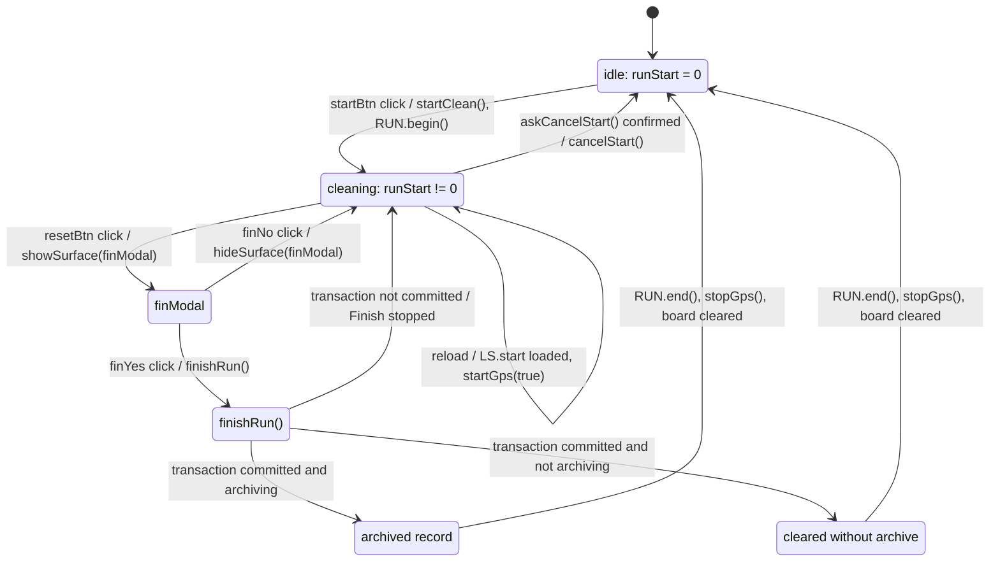
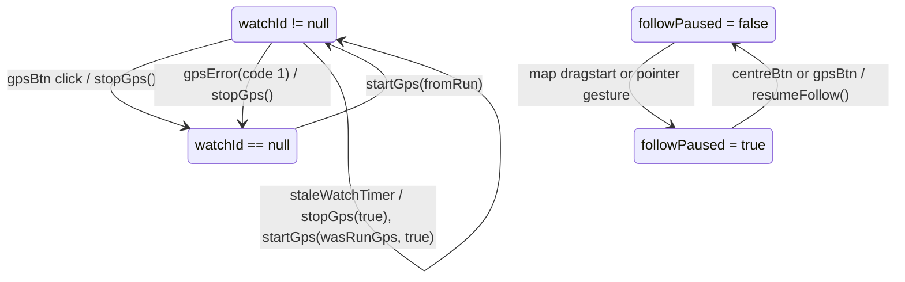
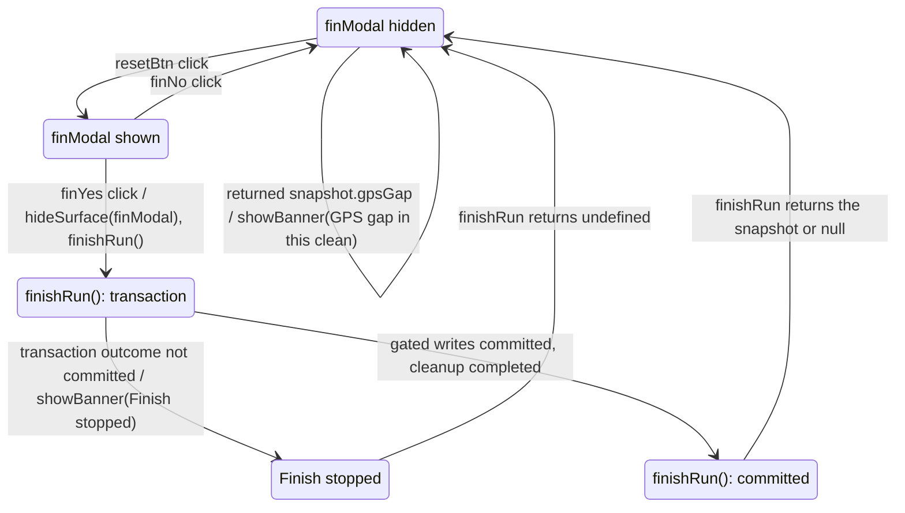
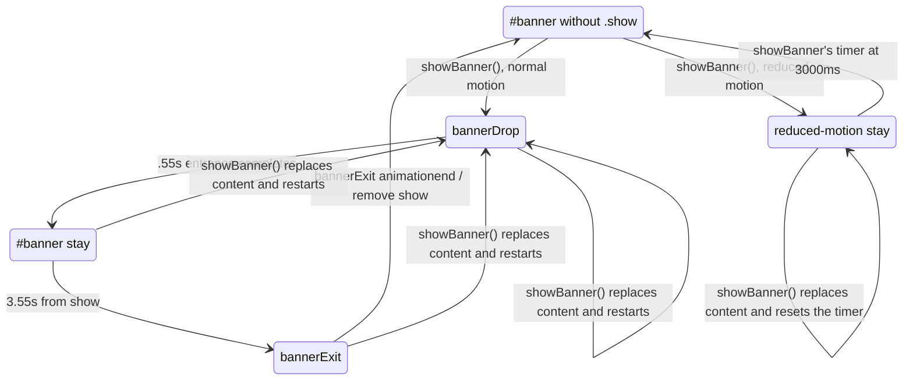
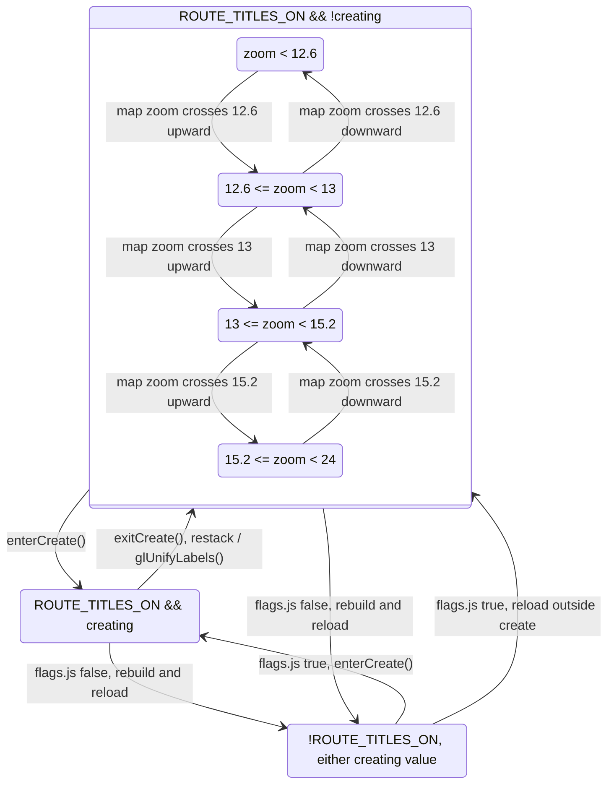

# State models

The app's three flows with ordering or timing rules that
must never be violated, written as state models with named
invariants (STD-07). Each invariant is stated so a check
can observe it; the map at the end names the check that
observes each one, or the gap where none does yet. The
models describe the code as it stands - a model that
flatters the code is worse than no model, so where the
code does less than a reader might expect, the model
says so.

One ruling binds the finish model (Andrew, 2026-11-26):
the finish flow is modelled as it actually behaves. No
banner exclusion during Finish is built, claimed or
implied as a defect anywhere in this document, and the
nightly fuzz round (G-E) asserts no such exclusion. The
one non-obstruction guarantee in force is the shipped
Beta 1.295 one: the GPS-gap advisory fires only after a
finish fully completes.

## Model 1 - the clean lifecycle

Seats: the RUN owner, startClean, cancelStart and the
stale-watch watchdog in parts/app3.js; the persisted
start load in parts/app1.js; GPS resumption at route
load in parts/app5.js. A "clean" is the user's word; the
code's identity for it is `runStart`.

The finish transaction arms a durable cleanup obligation
(`LS.finclean`) as its first step; the post-commit
saveAll discharges it. If the page dies mid-finish, the
next load completes the cleanup (an armed obligation) and
reconciles an interrupted finish against the archive
(finishReconcileAction / finishReconcileNoRunAction,
parts/app1.js). The archived and cleared states above
are transaction outcomes, not screens; finishRun performs
the teardown before it returns.

GPS, following and page visibility are orthogonal to the
clean identity:

Pausing following never pauses recording: a fix records
whenever `runStart && gpsFromRun`, whatever followPaused
says. Hiding the page flushes persistence
(PERSIST.flush(true) on visibilitychange-hidden and on
pagehide) and releases the wake lock through syncWake;
nothing stops the watch or the clean. The watchdog,
armed inside startGps, polls every 15 s: silence is
`Date.now() - Math.max(lastFixAt, watchStartedAt) >
45000` (GPS_STALE_MS, parts/app1.js). On silence it
stamps the clean's pending gap flag - only when the
watch is the clean's, a clean is live, and the clean
itself is older than 45 s - then restarts the watch,
preserving a deliberate follow suspension.

What survives a mid-clean reload, exactly: the persisted
half - the start key, the board, the snapshot, the
trail/session data, the distance counter's banked
records. What does not: the watch handle (a fresh watch
starts at route load) and the pending gap flag -
`gpsGapRuns` is an in-memory Map, never written to
storage. The archived record's `gpsGap: true` stamp is
the durable half of the gap story.

### Clean invariants

- **C1 - Clean identity.** After startClean(), `runStart`
  is nonzero, the start key is saved, and the Start/Finish
  UI stands. A zero identity, or a missing saved identity
  after a successful save, falsifies it.
- **C2 - Silence marks a pending gap.** With a recording
  watch, a clean older than 45 s, and silence over 45 s,
  a watchdog tick sets `gpsGapRuns.get(LS.start) ===
  runStart` and restarts the watch. Exactly 45 s does not
  satisfy the strict threshold.
- **C3 - Follow suspension preserves recording.** A map
  drag pauses following; the watch, its run ownership and
  the clean identity all remain, and fixes keep recording
  trail and coverage while paused.
- **C4 - Hidden page preserves the clean.** Hiding the
  page flushes pending writes to storage and releases
  the wake lock; the clean identity and the watch are
  untouched. (No claim is made that the browser keeps
  delivering GPS callbacks while hidden.)
- **C5 - Reload preserves only persisted state.** After
  a mid-clean reload, `runStart` resumes from the start
  key and recording re-establishes; the pending gap flag
  does not resume, so a gap seen only before the reload
  never reaches the archive.
- **C6 - The archive gap stamp is durable.** A clean
  whose pending flag stands at finish, and which
  archives, stores `gpsGap: true` on its history entry,
  readable after reload.
- **C7 - Archive eligibility is exact.** A finish
  archives when at least three streets are done, or when
  a nonempty short route is fully done. A partial clean
  under three streets clears without an archive. Notes
  alone never archive.
- **C8 - Cancellation restores the pre-clean board.**
  After a confirmed cancelStart(), the board equals its
  pre-Start snapshot (in memory, else the persisted
  snapshot, else the stamp-journal fallback), no history
  was written, and the clean identity is zero.

## Model 2 - finish flow and the banner

Seats: the Finish handlers and finishRun in
parts/app3.js; the one banner owner, showBanner, in
parts/app1.js; the banner CSS in parts/head.html.
`finModal` is the Finish confirmation, distinct from the
shared confirmPill other questions use.

The last transition is synchronous, inside the same
finYes handler, after finishRun() returns. There is no
advisory queue anywhere in the app. On failure the
"Finish stopped" banner is the transaction's own report,
emitted inside finishRun before it returns (the degraded
outcome - an unverified rollback - is judged first and
worded as such); the clean stays intact on a clean
rollback. That emission is the flow's failure surface,
recorded here as the behaviour Andrew's ruling keeps.

There is one `#banner` element and one owner, showBanner
(34 call sites across parts/), and a new call replaces
the showing notification - content, animation and the
reduced-motion timer all restart, so a superseded timer
can never hide a replacement. The banner wears
`pointer-events: none` and theme faces (`--card-solid`,
`--ink`). Unrelated notifications are not blocked during
the finish flow: a banner raised by another path can be
up while finModal waits or finishRun runs. That is the
shipped behaviour the ruling keeps; the finish flow's
own emissions are what the invariants below govern.

### Finish / banner invariants

- **F1 - The advisory never obstructs its own finish.**
  Between the finYes press and finishRun() returning,
  the finish flow raises no banner of its own except the
  failure report on a non-committed outcome; the gap
  advisory is raised only in the handler step after the
  return. A gap advisory sampled while finModal waits,
  or before the save completes, falsifies it.
- **F2 - Advisory follows a committed return.** The gap
  advisory fires only when finishRun() returned the
  archived snapshot for that clean - never before the
  return, never after a non-committed outcome.
- **F3 - One banner carrier.** Exactly one #banner
  exists; a re-fire during entrance, stay or exit
  replaces the content and restarts the lifecycle; no
  second carrier appears and no stale timer hides the
  replacement. (Delivery of every notification is not
  promised - replacement is the policy.)
- **F4 - The advisory belongs to the completed clean.**
  The stamp the advisory rests on is keyed to the exact
  runStart that finished (gpsGapRuns is keyed by start
  key and checked against runStart at buildSnap). A
  cancelled clean's flag dies with it (RUN.end), and no
  delayed advisory exists that could fire after the user
  leaves the flow - emission is synchronous in the
  committing handler.
- **F5 - The advisory requires a stamped archive.** The
  advisory fires only when the returned snapshot - the
  one just written to history - carries `gpsGap: true`.
  A pending flag on a clean that clears without
  archiving produces no advisory.
- **F6 - A failed save releases no advisory.** With a
  gap pending and the archive write failing, the finish
  stops, "Finish stopped" shows, the clean stays intact
  for a retry, and no gap advisory fires for the failed
  attempt - at any transaction step, including a
  degraded rollback. A later successful finish of the
  same clean advises on its own outcome.
- **F7 - Banner lifecycle and faces.** The drop is .55 s
  with the recoil settle, the stay ends into a .4 s exit
  at 3.55 s, reduced motion holds a plain 3 s stay, the
  banner never takes pointer events, and both theme
  faces meet the contrast floor. The banner rests level
  with the title.

## Model 3 - label handover

Seats: the naming owner in parts/app2.js - addRouteTitles
and glUnifyLabels, reading the one constant
ROUTE_LABEL_ZOOM = 15.2; the source-only switch
ROUTE_TITLES_ON in flags.js; the creation backdrop in
the same part (setRouteBackdrop re-runs the unify pass).
The state is the product (zoom band x ROUTE_TITLES_ON x
creating), factored here to avoid duplicating the zoom
transitions:

Zoom changes evaluate layer specifications; nothing
toggles title visibility or rebuilds the source at a
crossing. The `ramp` band does not put every title on
screen at 12.6: the four title tiers have minimum zooms
13.7, 13.35, 13.0, 12.6, and share one opacity ramp,
0 at 12.59 to 1 at 12.62. With the policy on and not
creating: titles (maxzoom 15.2, no fade at the top)
name the route below 15.2; at 15.2 the clones
(roads_labels_major-route / roads_labels_minor-route,
minzoom 15.2, maxzoom 24, the base filter AND a
route-name inclusion) take route naming over, instantly;
original road-label layers carry the route-name
exclusion at every zoom, floor 13, and symbol-spacing
250 on both carriers. With the switch off, no title
layers, no labelpts source and no clones exist, and the
originals keep their base filters. Creating removes the
clones and lifts the exclusion (the handover predicate
is `titlesOn && !creating`), and the route stack itself
may be hidden as the creation backdrop; exit restores
the policy through the same unify pass.

### Label invariants

- **L1 - Exact carrier boundary.** Title layers read
  maxzoom 15.2 and clone layers minzoom 15.2 in the live
  style; at 15.199 titles own route naming, at 15.2 the
  clones do.
- **L2 - Clone-side positive witness.** Above 15.2,
  rendered features from the clone layers include known
  route street names; below it, the titles carry them.
  A handover claim with an empty witness set on either
  side proves nothing.
- **L3 - Original exclusion, clone inclusion.** Original
  road-label filters reject every ROUTE_TILE_NAMES name
  and the clones admit exactly those names on top of
  their base filters; non-route names never enter the
  clones.
- **L4 - Instant switch.** No fade ramp exists at 15.2
  on either carrier (title text-opacity transition is
  duration 0; clones carry no fade); crossings in both
  directions switch at the same zoom.
- **L5 - Low-zoom behaviour stands.** Tier minimums
  13.7 / 13.35 / 13.0 / 12.6, centred anchor, zero
  radial offset, and the 12.59-12.62 opacity ramp are
  as specified.
- **L6 - Floor and repetition.** Original road-label
  floor is 13, clone floor is 15.2, both maxzoom 24,
  and symbol-spacing is 250 on originals and clones.
- **L7 - The switch disables the whole policy.** In a
  build with ROUTE_TITLES_ON off: no labelpts source,
  no title layers, no clones, no route-name exclusion,
  and route streets are named by the originals above
  floor 13.
- **L8 - Create mode restores ordinary naming.** While
  creating, no clones exist and the originals carry no
  route-name exclusion; on exit, the policy (clones,
  exclusion) is restored by the unify pass.
- **L9 - Both themes, repeated crossings.** L1-L8 hold
  in day and night and after repeated crossings and
  restacks: no stale exclusion list, no duplicate or
  lost clone.

## Invariant-to-check map

Status is exactly one per invariant: **existing** (a
check already in the battery observes it), **new** (a
check added by this round observes it), or **gap** (no
check observes it yet - the gaps table below; gaps feed
the G-E fuzz round's invariant registry). The trial
column names the formal-trial property where one exists;
the trial checks the model, the checks check the app.

| Invariant | Status | Observing check | Trial |
|---|---|---|---|
| C1 | existing | drive225 S1 | - |
| C2 | existing | drive225 G1, G2 (constants: proof-1304) | - |
| C3 | new | drive232 C3 case | - |
| C4 | new | drive232 C4 case | - |
| C5 | new | drive232 C5 case | - |
| C6 | existing | drive225 G4 (negative half: drive232 C5) | - |
| C7 | new | drive89 T3 + drive225 G4 (>= 3 arm); drive232 C7 case (< 3 arm); full-short-route arm: GAP-1 | - |
| C8 | existing | drive114 M7a | - |
| F1 | new | drive232 F1 case; proof-1304 (handler order); drive225 G3 | F1 |
| F2 | existing | drive225 G4, G5 | F2 |
| F3 | new | drive232 F3 cases | TypeOK |
| F4 | existing | drive225 G2, G11 | F4 |
| F5 | existing | drive225 G4, G5, G11 | F5 |
| F6 | new | drive232 F6 case (support: drive136 F3, drive118 T9) | F6 |
| F7 | existing | drive225 G6, G7, G8, G9; drive204 (constants: proof-1304) | - |
| L1 | existing | drive219 phase N spec reads; drive216 P3b | - |
| L2 | existing | drive216 P3b, P4b | - |
| L3 | existing | drive219 phase N filter reads | - |
| L4 | existing | drive219 phase V; phase N opacity reads | - |
| L5 | existing | drive216 P1; proof-1304 (tier + ramp pins) | - |
| L6 | existing | drive219 phase N reads; proof-1259 check 12 | - |
| L7 | existing | drive219 phase Z (Z1 + filter reads) | - |
| L8 | new | proof-1304 (handover predicate pin); fuzz registry L8 witness (G-E) | - |
| L9 | existing | drive216 P3, P4, P6 | - |

Counts: 24 invariants - 16 observed by existing checks,
8 observed by checks new in this round, 0 wholly
unobserved. Two sub-arms were gaps; GAP-2 closed by the
G-E fuzz registry (2026-11-28) - one sub-arm remains.

### Gaps

- **GAP-1 (C7, full-short-route arm).** No battery
  scenario finishes a created short route at full
  completion and reads its archive. The arm is one
  clause of finishRun's archiving expression, pinned
  verbatim at the source seat by proof-1304. The G-E
  registry did not take it - the fuzz fixture is Route
  5W, and a created short route finished in full is a
  fixture of its own - so the gap stays recorded.
- **GAP-2 (L8, create-mode clone absence) - CLOSED by
  G-E (2026-11-28).** The fuzz registry's L8 witness
  (tests/browser/fuzz.mjs, inside the Discard action)
  asserts clone absence and exclusion lift while create
  mode is open, and their restoration on exit,
  behaviourally in the browser.

## The formal-verification trial

Scope: the finish-flow / banner interaction only
(STD-07's one approved trial). Tool: TLA+ with the TLC
model checker - a small finite-state model can enumerate
the competing notification requests, the confirmation,
the save outcomes and the replacement semantics
exhaustively, which is the ordering question; a stateful
JS property harness would be the pick if handler fidelity
became the question instead. The spec is
tests/formal/FinishFlow.tla with FinishFlow.cfg beside
it (MaxClean = 3).

In the model: the finish actor (idle / cleaning /
confirming / saving / returned), the banner (hidden /
showing, one kind at a time - the single-carrier shape
F3 asserts, carried in TypeOK), the pending gap flag and
the archive stamp, save outcomes committed / failed /
degraded (a failed save returns to the live clean -
finishRun returns before RUN.end, so the same clean
can be finished again), clean identity (ids never
reused), and one
nondeterministic ordinary-notification action enabled in
every phase, modelling the as-is absence of an exclusion.
Out of the model: map rendering, CSS interpolation and
the timing constants, GPS accuracy and trail geometry,
archive eligibility computation (an abstract input),
storage internals (outcomes are inputs), and the
browser's real event loop.

Properties checked (the safety half of F1-F6, stated
over emission-basis history where the property is about
the moment of emission): F1 the advisory for a clean
never shows while that clean's finish is in flight; F2
it rests on that clean's commit; F4 it never belongs to
a cancelled clean; F5 it rests on that clean's stamp;
F6 the advisory's own attempt committed - a failed
attempt releases none, and a successful retry of the
same clean advises on its own outcome.

Result, as run (raw output in the G-C round folder,
reproduction command in its RECORD.md): TLC, exit 0 -
no error found; 12,111 states generated, 3,496 distinct
states, state-graph depth 23, all six invariants holding
(TypeOK + F1, F2, F4, F5, F6). The properties were also
run against three deliberately broken variants of the
spec: an advisory allowed inside the save window fails
F1 (violating state: phase "saving", the gap banner up
for clean 1 with no commit recorded), an advisory
allowed without the stamp fails F5 (the gap banner up
for a clean whose snapshot was never stamped), and a
failed save masquerading as a completed finish fails
F6 (the gap banner up for clean 1 with its commit and
stamp bases both reading clean 1, but the emitting
attempt's outcome "failed" - a history-based F6, which
asks only whether the clean ever failed, cannot state
this, and it would also have forbidden the legitimate
advisory after a successful retry). A
successful run proves the finite model under its
abstractions - not production refinement, not rendering,
not the real event loop. The numbered invariants stay
the checked contract: actionable counterexamples become
browser drives with mutation receipts, and the model is
updated or retired when production ownership changes.
